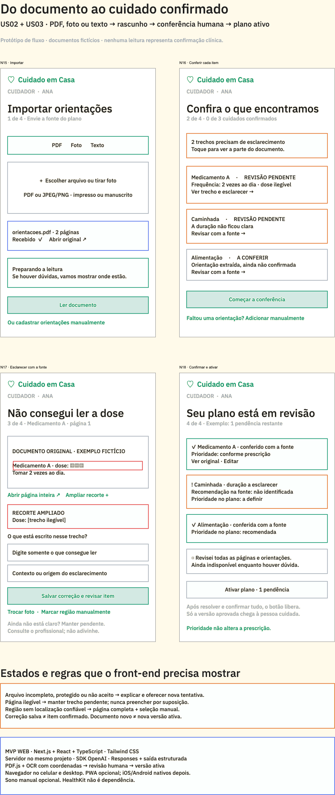
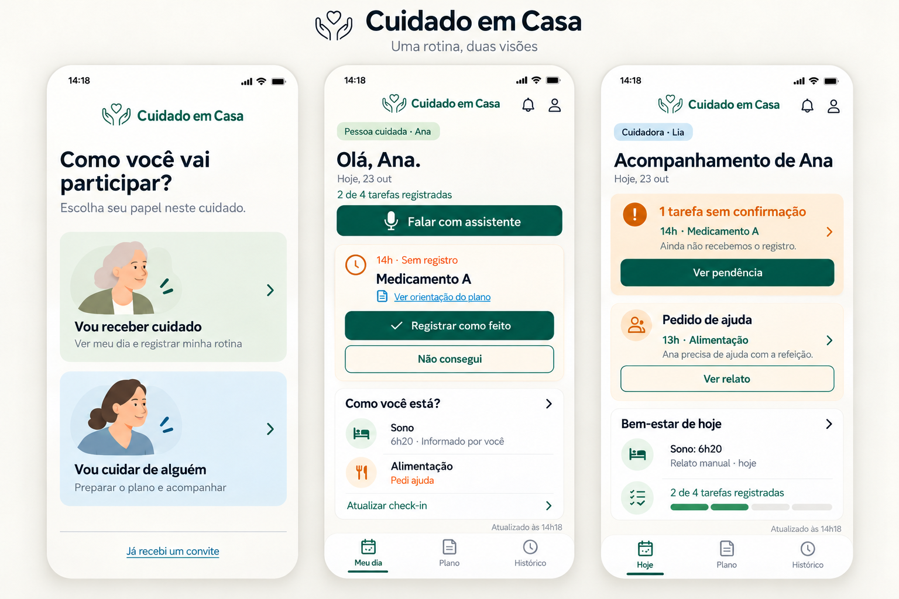
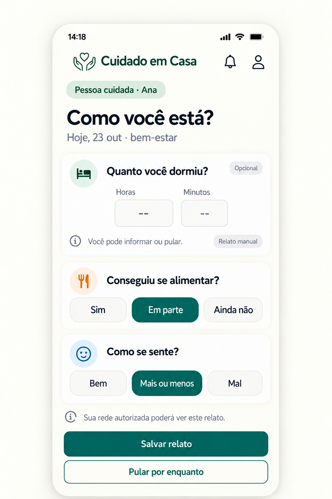

# Wireframes e imagens

As imagens são referências visuais, não comprovação de funcionalidades implementadas. O [PRD final](../product/prd.md) e o [resumo de decisões](../product/direction.md) definem o escopo vigente.

## Referências atuais

Sono manual opcional, rotina das duas pessoas e sequência de importação/revisão. A referência de revisão ainda mostra recursos adiados: manuscritos, seleção manual de região e atualização de plano. Reaproveitar a sequência e ajustar essas diferenças na implementação.

### Importar, revisar, esclarecer e ativar

### Entrada e duas visões

### Sono manual opcional

## Histórico preservado

Estas versões guardam a exploração anterior. Incluem telas com vários cuidadores, HealthKit, mudança de plano e fila offline que não devem ser implementadas no MVP atual. Ajuda urgente deve seguir o fluxo próprio do PRD final.

- [cuidado-em-casa-01-visoes-com-voz](archive/cuidado-em-casa-01-visoes-com-voz.png)
- [cuidado-em-casa-01-visoes](archive/cuidado-em-casa-01-visoes.png)
- [cuidado-em-casa-02-entrada-plano](archive/cuidado-em-casa-02-entrada-plano.png)
- [cuidado-em-casa-03-registro-ajuda](archive/cuidado-em-casa-03-registro-ajuda.png)
- [cuidado-em-casa-04-voz](archive/cuidado-em-casa-04-voz.png)
- [painel-core-v3](archive/painel-core-v3.png)
- [painel-help-v3](archive/painel-help-v3.png)
- [painel-voice-v3](archive/painel-voice-v3.png)
- [tela-01-enviar-orientacoes](archive/tela-01-enviar-orientacoes.png)
- [tela-02-cadastrar-tarefa](archive/tela-02-cadastrar-tarefa.png)
- [tela-03-revisar-versao](archive/tela-03-revisar-versao.png)
- [tela-04-rede-de-cuidado](archive/tela-04-rede-de-cuidado.png)
- [tela-05-convidar-cuidador](archive/tela-05-convidar-cuidador.png)
- [tela-06-convite-indisponivel](archive/tela-06-convite-indisponivel.png)
- [tela-07-corrigir-registro](archive/tela-07-corrigir-registro.png)
- [tela-08-bem-estar-healthkit](archive/tela-08-bem-estar-healthkit.png)
- [tela-09-sincronizacao-pendente](archive/tela-09-sincronizacao-pendente.png)
- [tela-10-coordenar-ajuda](archive/tela-10-coordenar-ajuda.png)
- [tela-11-pendencia-cuidador](archive/tela-11-pendencia-cuidador.png)
- [tela-12-voz-indisponivel](archive/tela-12-voz-indisponivel.png)
- [tela-13-aceitar-convite](archive/tela-13-aceitar-convite.png)
- [tela-14-ativar-plano](archive/tela-14-ativar-plano.png)

## Fontes e integridade

- [Quadro original no tldraw](https://www.tldraw.com/f/cx_sqUW3D1tTCo5FQg8VA)
- [Índice de arquivos e hashes SHA-256](assets.json)
- [Sequência de importação no tldraw](source/importacao.js)
- [Cópia nativa de recuperação, com imagens incorporadas](cuidado-em-casa-recuperado.tldr)
- A pasta `source/` preserva os trechos textuais de construção e revisão dos wireframes. São registros históricos, dependentes do contexto do editor, e não um script único pronto para executar.
- As imagens completas ficam neste repositório e não dependem do carregamento do quadro externo.
- Em 23/10, a thread de recuperação observou que as páginas sumiam ao recarregar o quadro online. A cópia local foi preservada; ela não comprova que a sincronização remota foi corrigida.

## Ajustes visuais de 23 de outubro

A direção de cores, tipografia e hierarquia do tldraw foi preservada. Por orientação posterior de John, a interface normal não mostra rótulos de demonstração ou dados fictícios, nem status permanente de atualização. O perfil usa retrato ilustrado circular e primeiro nome. A natureza sintética dos casos permanece documentada tecnicamente. Os retratos locais `public/images/helena-avatar.png` e `marina-avatar.png` foram gerados com Image Gen: mulher idosa de cabelo prateado e mulher adulta de cabelo castanho, ambas em ilustração editorial suave, com fundo verde/azul claro e enquadramento de cabeça e ombros.
