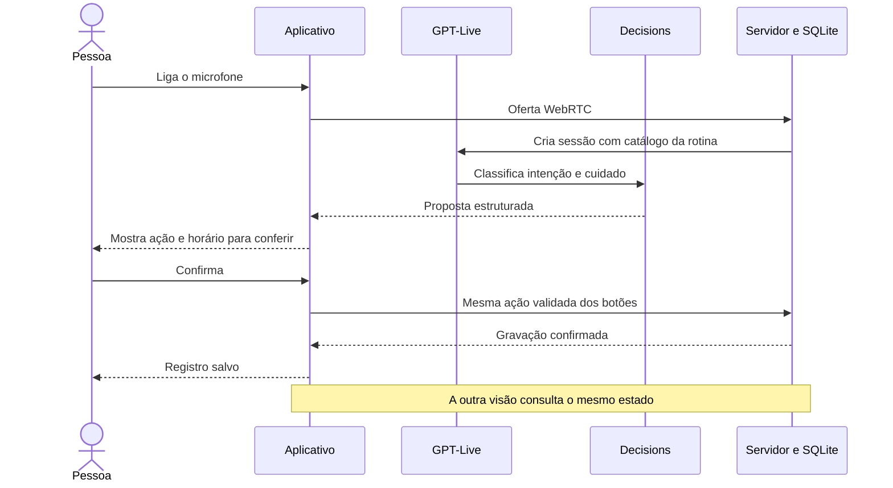

# Ambiente local

O MVP roda em um único processo Next.js, com SQLite e arquivos privados no disco local. Não exige provisionar banco ou armazenamento externo para desenvolver.

| Camada | Implementação |
| --- | --- |
| Web | Next.js App Router, React, TypeScript, CSS responsivo |
| Servidor | Route Handlers; chave OpenAI somente no servidor |
| Persistência | SQLite por `@libsql/client`, em `.data/` |
| Documentos | Original privado; PDF.js com páginas e zoom; JPEG, PNG ou texto |
| Extração | Responses, `gpt-6.1-sol`, Structured Outputs e Zod |
| Voz | GPT-Live `gpt-live-1`, WebRTC e Decisions `gpt-6-luna` |
| Verificação | Node Test Runner e Playwright, além de inspeção no navegador |

As versões exatas estão no lockfile. Os comandos usam Webpack porque o Turbopack falhou ao abrir a porta interna do compilador CSS neste ambiente.

## Execução

```sh
npm ci
npm run doctor
npm run dev
```

Abra `http://127.0.0.1:3000`. Uma rotina pronta permite alternar entre paciente e acompanhante. “Preparar novo plano” cria outro caso, sem apagar os anteriores.

`OPENAI_API_KEY` é lida do ambiente ou de `.env.local`. John autorizou a chave existente; não é necessário gerar outra. Nunca usar `NEXT_PUBLIC_` para credenciais. Nenhuma chamada à OpenAI ocorre durante o build ou ao simplesmente abrir a rotina.

## Contratos do produto

- A extração gera um rascunho. O acompanhante corrige e confirma cada cuidado, esclarece pendências e declara que leu todas as páginas antes da ativação.
- Horários operacionais são definidos explicitamente; a aplicação não inventa horários a partir de intervalos prescritos.
- O plano ativo é fixo. Registros, correções e ajuda têm autor, horário e histórico.
- A gravação é online. Tentativas repetidas usam a mesma identidade e não duplicam a ação. Falha de rede não é apresentada como sucesso.
- Ajuda urgente tem acesso próprio e ligação independente para o SAMU. Resolver ajuda não conclui a tarefa.

## Voz vinculada às ações



A voz pode registrar tarefa feita/não feita, pouco/suficiente/muito sono, alimentação completa/parcial/ausente e pedido de apoio. Uma pergunta, intenção futura ou referência ambígua não autoriza registro. A aplicação pausa o microfone enquanto a proposta aguarda confirmação. Cancelar não grava; repetir a mesma decisão não abre outra proposta. Relatos de alimentação preservam os dados de sono e humor do mesmo dia.

## Limites desta versão

As identidades e casos são sintéticos. Entrar por um link de caso é uma conveniência de desenvolvimento, não autenticação de produção. O servidor aplica papéis e isolamento entre casos, mas ainda faltam contas reais e convites seguros.

Para publicar, é preciso definir banco compartilhado e armazenamento privado persistente. SQLite em disco efêmero de funções não atende a esse requisito. Não há fila offline, push, aplicativo nativo, HealthKit ou mudança de tratamento pela IA.

A extração não foi validada clinicamente. Não promete leitura confiável de manuscritos; campos incertos permanecem pendentes. Veja [validação](validation.md).
