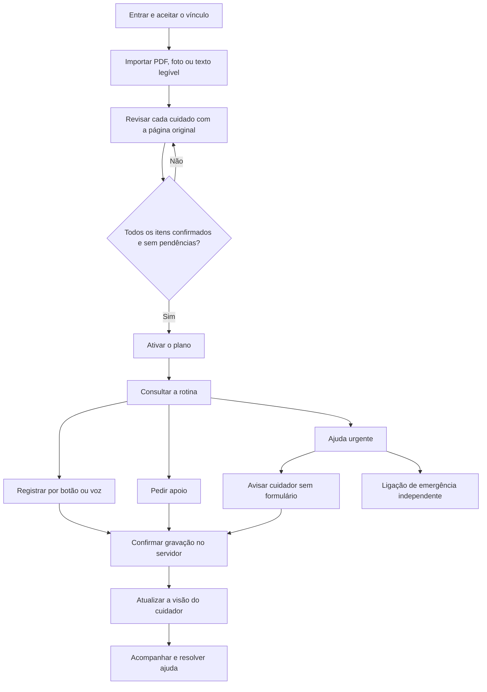

# Direção do MVP

Resumo do [PRD](prd.md) e das decisões posteriores, atualizado em 23 de outubro de 2026. O PRD preserva o documento de origem; as decisões abaixo registram o recorte atual.

## Decisões posteriores para a demo local

- Foco exclusivo em mobile. As verificações atuais usam 320 e 390 px; desktop não é critério desta entrega.
- Os perfis de Helena e Marina compartilham a mesma rotina de demonstração. Cadastro e login locais de cuidador existem, mas convites entre contas ficam fora deste recorte.
- Avisos ficam compactos; detalhes aparecem ao abrir. A interface cotidiana dispensa rótulos repetidos de demonstração, mantendo essa informação na entrada e documentação.
- O sono oferece faixas rápidas e duração exata opcional. Uma faixa nunca vira um número exato de minutos.
- A revisão individual usa uma ação para salvar, confirmar e voltar à lista. A conferência geral confirma os itens elegíveis ou mostra os cuidados que ainda exigem atenção.
- A voz apresenta um cuidado relevante por vez. Uma intenção de registro gera confirmação visível; apenas o aceite da pessoa grava o resultado.

## Resultado esperado

Uma pessoa cuidada e um único cuidador consultam o mesmo plano confirmado e compartilham registros e pedidos de ajuda. A demonstração é uma web app interativa em celular e desktop, com dados sintéticos e conexão para salvar.

## Jornada principal

## Decisões de escopo

| Tema | Decisão vigente |
| --- | --- |
| Plataforma | Next.js, React e TypeScript; foco de implementação e aceite em mobile |
| Participantes | Uma pessoa cuidada e um cuidador; escolher papel não concede acesso |
| Documento | Texto impresso legível em PDF/foto ou texto colado; alternativa manual quando a leitura falhar |
| Fonte | Página original com zoom e trecho transcrito; destaque aproximado opcional |
| Conferência | Nenhum item confirmado pela IA; correção não equivale a confirmação |
| Plano | Ativação uma vez; edição e versionamento do plano ativo ficam para depois |
| Registros | Compartilhados online; confirmar a gravação, mostrar erro e permitir nova tentativa sem duplicar |
| Voz | GPT-Live + Decisions; mesmas regras e ações dos botões |
| Apoio | Pedido e resolução não concluem automaticamente a tarefa |
| Ajuda urgente | Fluxo próprio com acesso destacado, aviso ao cuidador sem formulário e atalho de ligação |
| Bem-estar | Sono, alimentação e como a pessoa se sente são relatos manuais opcionais |
| Depois do MVP | Vários cuidadores, manuscritos/documentos difíceis, OCR dedicado, recortes precisos, editor de regiões, fila offline, HealthKit, aplicativos nativos e push |

## Regras para implementar as telas

- Diferenciar informação ausente, leitura ambígua e texto ilegível. Não completar campos por suposição.
- Preservar a origem de cada orientação. Uma dúvida impede a ativação.
- Exibir tentativa de gravação, sucesso e falha como estados distintos.
- Distinguir falta de registro de uma declaração de que o cuidado não foi realizado.
- Permitir os mesmos resultados por botões e voz; a voz só anuncia sucesso após o servidor confirmar.
- Não tratar relato opcional ausente como zero nem gerar alerta por não preenchê-lo.
- Uma ligação aberta ou um pedido gravado não comprova contato ou socorro a caminho.

## Referências

- [PRD no Google Docs](https://docs.google.com/document/d/1bYOPkNtU2AimgIiz0x1N1i_J7iWEkXc_lM0kLTs29Ok/edit)
- [Quadro no tldraw](https://www.tldraw.com/f/cx_sqUW3D1tTCo5FQg8VA)
- [Imagens e histórico visual](../design/README.md)
